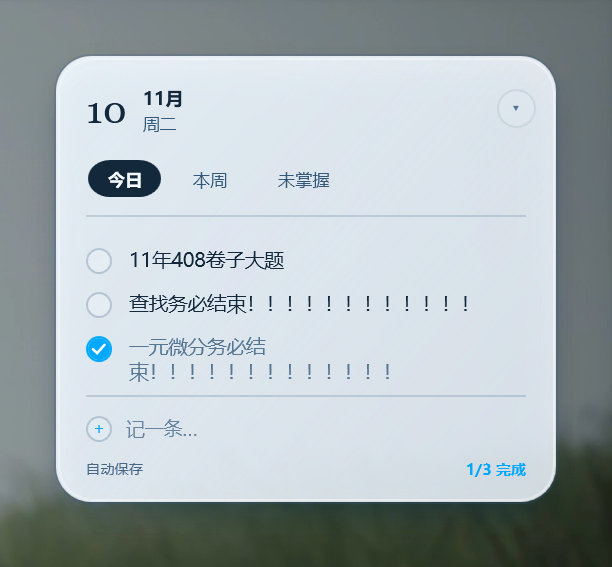

# 易便签 · Easy Note

一块钉在桌面右上角的常驻便签，用来记「今天要做什么」「这周要做什么」「哪些知识点还没掌握」。Windows 11 桌面端，.NET 8 + WPF。



## 特点

- **钉死在桌面右上角**：位置固定，鼠标拖不动；换分辨率或改缩放了会自动回到角落（右边距 / 上边距各 24px）
- **只贴在壁纸之上**：窗口层级夹在桌面层和所有程序窗口之间——你开 PDF、看网课，它被正常盖住；回到桌面它还在，按 Win+D 也会跟着露出来。任何时候都不会浮在别的软件上面
- **三块面板**：今日 / 本周 / 未掌握，各自独立，互不干扰
- **勾选式清单**：回车新增一条、空行按退格删掉、上下键切换、勾选后变灰；行尾悬停出现删除按钮
- **自动保存**：改一个字就落盘，本地 JSON，没有账号没有同步
- **轻**：单文件 exe，自带 .NET 运行时，同学机器上双击就能装，不需要另装任何东西
- **托盘常驻**：显示/隐藏、折叠/展开、开机自启

## 窗口层级是怎么做的

桌面便签最容易翻车的地方是"什么时候该在、什么时候不该在"。这里的规则只有一条：

> **紧贴桌面层之上，但在所有普通程序窗口之下。**

实现上每 300ms 校正一次（`ShellPin.PlaceOnDesktop`）：

1. 按 z 序枚举所有**可见**的顶层窗口；
2. 找到最上面那个"桌面层"窗口 D（`Progman` / `WorkerW` / `SHELLDLL_DefView` / `SysListView32`）；
3. 把自己插到 D 的正上方（也就是插在"当前位于 D 上面那个窗口"的下面）。

这样桌面被抬起来（Win+D、显示桌面、隐藏桌面图标）时便签跟着露出来，而任何程序窗口一出现就自然盖住它。窗口被点击激活后会立刻被压回去，靠的是 `WM_ACTIVATE` + 定时校正；`WM_SYSCOMMAND(SC_MINIMIZE)` 和 `WM_SIZE(SIZE_MINIMIZED)` 被拦下并原地恢复，所以最小化也藏不住它。

不做 `SetParent` 到 `WorkerW` 的原因：那套经典做法要求桌面层没有其他 DirectComposition 内容。机器上跑着视频壁纸（Wallpaper Engine 一类）时整个桌面层被它的合成内容盖住，实测 WPF / WinForms / 原生 `WS_CHILD` 三种方式贴上去都是 0 像素——所以走 z 序方案，效果等价且不依赖壁纸软件。

## 目录

```
MainWindow.xaml / .cs     界面（雾银玻璃卡片）、清单交互、层级校正
ShellPin.cs               窗口层级的低层操作（z 序、强制恢复、圆角位置）
Models.cs                 NoteItem / Board / Store（JSON 持久化）
App.xaml.cs               托盘图标与菜单、开机自启、单实例
DesktopPin → 已并入 ShellPin
installer/                Inno Setup 脚本（免管理员、可选安装目录）
tools/                    开发脚本（生成图标、截图、层级校验）
docs/screenshot.png       README 用的截图
```

## 界面配色

跟「词隙」同一套雾银玻璃语言：正文墨蓝 `#182633`、次要 `#5B7185`、强调冰蓝 `#2899D6`、玻璃面 `#CCF4F9FF`，24 圆角 + 两层柔光投影。想改配色直接改 `MainWindow.xaml` 顶部的 `SolidColorBrush` 资源块，改一处全局生效。

## 构建

```bash
dotnet build -c Release
```

## 打包成安装程序

```bash
# 1) 单文件、自带运行时
dotnet publish -c Release -r win-x64 --self-contained true \
  -p:PublishSingleFile=true -p:IncludeNativeLibrariesForSelfExtract=true \
  -p:EnableCompressionInSingleFile=true -p:DebugType=None -o build/publish

# 2) Inno Setup 6 编译（输出 build/dist/EasyNote-Setup-<版本>.exe）
"%LOCALAPPDATA%\Programs\Inno Setup 6\ISCC.exe" installer\DesktopNote.iss
```

安装包免管理员（`PrivilegesRequired=lowest`），装到当前用户；有 D 盘就默认 `D:\易便签`，否则 `%LOCALAPPDATA%\Programs\易便签`，向导里都能改。

## 数据位置

```
%APPDATA%\DesktopNote\notes.json
```

卸载不会删除，重装后内容还在。

## 许可

MIT
